<!-- markdownlint-disable MD033 -->
# 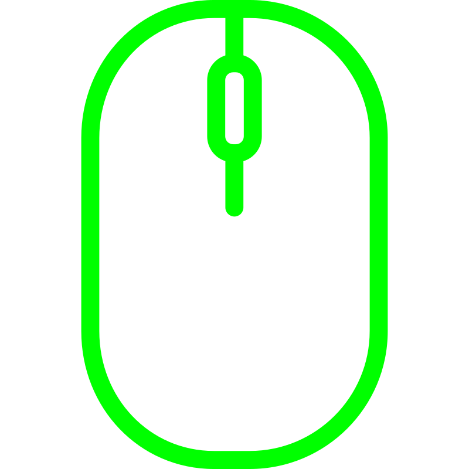 Viper Ultimate Tray <!-- omit in toc -->
<!-- markdownlint-enable MD033 -->

**Viper Ultimate Tray** is a Linux system tray application for managing the **Razer Viper Ultimate** wireless mouse.

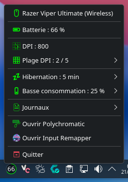

It provides a native KDE Plasma interface for monitoring the mouse and controlling its main settings, including battery status, DPI, power management, and charging-related options.

The application is designed for **Arch Linux and Arch-based distributions**, with **KDE Plasma 6 or newer** and **OpenRazer** as its hardware interface.

It supports both **Wayland and X11** sessions and is designed to handle wireless and wired operation, including mouse disconnection and reconnection.

## Table of contents <!-- omit in toc -->

- [Features](#features)
  - [Mouse status](#mouse-status)
    - [Tray indicator](#tray-indicator)
    - [Tray menu](#tray-menu)
  - [DPI](#dpi)
  - [Hibernation](#hibernation)
  - [Low-power mode](#low-power-mode)
  - [Notifications](#notifications)
    - [Low-battery notifications](#low-battery-notifications)
    - [Charge complete notification](#charge-complete-notification)
    - [Connection change notification](#connection-change-notification)
    - [Battery Logger start failure notification](#battery-logger-start-failure-notification)
  - [Battery logging](#battery-logging)
    - [Battery Logger](#battery-logger)
    - [Charge Data](#charge-data)
      - [Samples](#samples)
      - [Model](#model)
  - [Hotplug support](#hotplug-support)
  - [Mouse Poller](#mouse-poller)
  - [Multi-threading](#multi-threading)
- [Architecture](#architecture)
  - [Project structure](#project-structure)
- [Requirements](#requirements)
  - [Required](#required)
  - [Dependencies](#dependencies)
- [Installation](#installation)
  - [Reinstallation](#reinstallation)
- [Uninstallation](#uninstallation)
- [Development and testing](#development-and-testing)
  - [Local checks](#local-checks)
  - [Continuous integration](#continuous-integration)
- [Third-party assets](#third-party-assets)
- [License](#license)

## Features

- **Mouse status**: Monitor the mouse battery level, charging state, connection mode, and estimated charging time directly from the tray menu;
- **DPI**: Select the mouse DPI from the default DPI stages configured on the mouse;
- **Hibernation**: Configure the mouse hibernation timeout to control its power consumption while idle;
- **Low-power mode**: Configure the battery threshold at which the mouse enters low-power mode;
- **Notifications**: Receive notifications for low-battery thresholds, charging completion, and relevant connection or logging events;
- **Battery Logger**: Record battery activity in separate wired and wireless charging logs while tracking logging sessions and connection changes;
- **Charge Data**: Analyze recorded charging sessions, manage individual battery samples, and build separate charging models for wired and wireless operation;
- **Hotplug support**: Automatically detect mouse disconnection and reconnection while keeping monitoring and active logging sessions running;
- **Mouse Poller**: Continuously retrieve the mouse state in a dedicated background thread without blocking the graphical interface;
- **Multi-threading**: Run polling, battery logging, and charge-data processing outside the GUI thread to keep the interface responsive.

### Mouse status

Viper Ultimate Tray continuously monitors the current state of the mouse and provides both an at-a-glance status indicator in the system tray and detailed information in the tray menu.

#### Tray indicator

The tray indicator reflects the current battery level and charging state. It also indicates when the mouse is disconnected or in hibernation.

<!-- markdownlint-disable MD033 -->
<style>
  table.custom-table th,
  table.custom-table td {
    vertical-align: middle;
    text-align: center;
    padding: 12px;
  }
</style>
<table class="custom-table">
  <thead>
    <tr>
      <th>Percent ranges</th>
      <th>31–100 %</th>
      <th>16–30 %</th>
      <th>6–15 %</th>
      <th>0–5 %</th>
    </tr>
  </thead>
  <tbody>
    <tr>
      <td>Not Charging</td>
      <td></td>
      <td>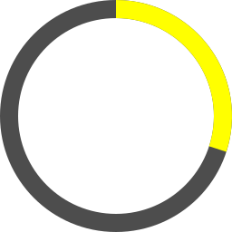</td>
      <td></td>
      <td>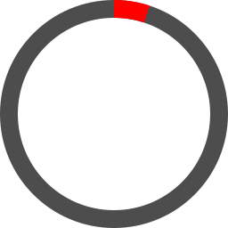</td>
    </tr>
    <tr>
      <td>Charging</td>
      <td colspan="4"></td>
    </tr>
    <tr>
      <td>Disconnected or in hibernation</td>
      <td colspan="4"></td>
    </tr>
  </tbody>
</table>
<!-- markdownlint-enable MD033 -->

#### Tray menu

The tray menu displays the current connection mode, battery level, and charging state.


When the mouse is disconnected, mouse-specific controls are disabled until the mouse becomes available again.

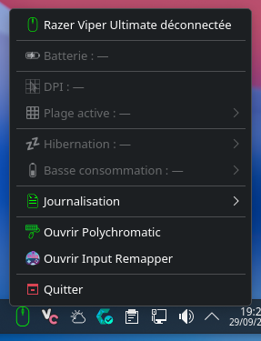

<!-- markdownlint-disable MD033 -->
|Percent ranges|76–100 %|51–75 %|26–50 %|11–25 %|0–10 %|
|:--------:|:--------:|:--------:|:--------:|:--------:|:--------:|
|Not charging|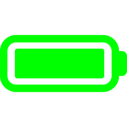|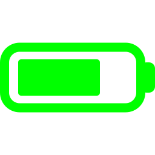|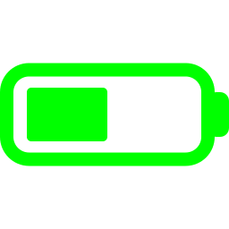|||
|Charging|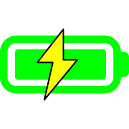|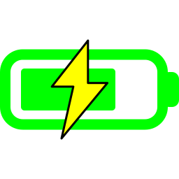|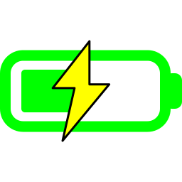|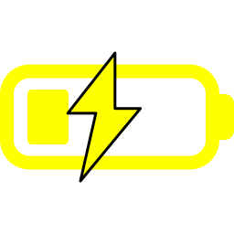|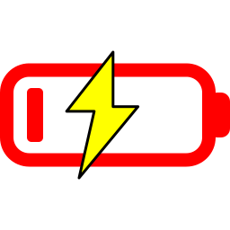|
<!-- markdownlint-enable MD033 -->

The application distinguishes between wired and wireless operation and uses the corresponding charging data when estimating the remaining charging time.

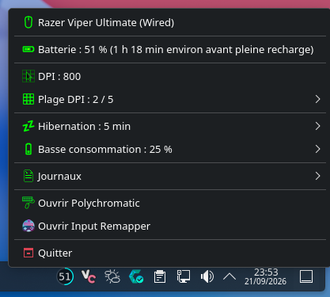 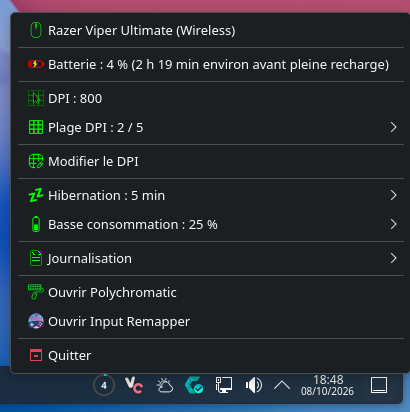

### DPI

Viper Ultimate Tray allows the active DPI stage to be selected directly from the tray menu. The available stages are read from the DPI stages configured on the mouse.

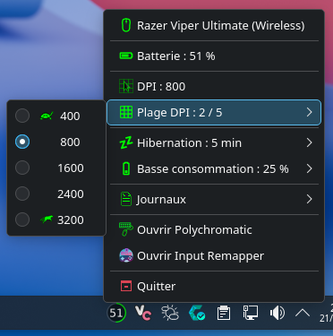

Changing the selected stage updates the active DPI stage on the mouse. The corresponding DPI value is applied immediately, and the mouse's physical DPI indicator LED reflects the active stage.

The DPI stage remains synchronized with the mouse in both directions. Selecting a stage in the application changes the mouse DPI and its physical indicator, while changing the DPI stage using the physical DPI button on the mouse updates the active stage displayed in the tray menu.

### Hibernation

Viper Ultimate Tray allows the mouse hibernation timeout to be configured directly from the tray menu.

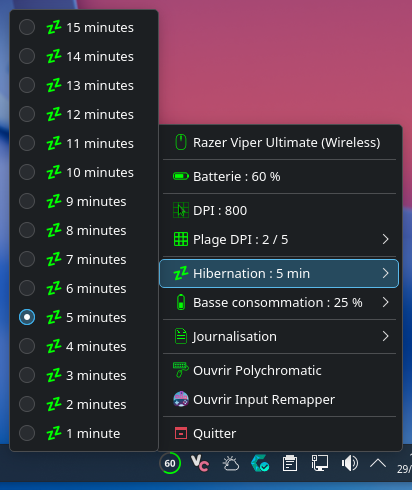

The configured timeout determines how long the mouse can remain idle before entering hibernation.

When the mouse is hibernating, its battery state is no longer available. Viper Ultimate Tray indicates this state in the tray and displays `Batterie : —` in the tray menu.

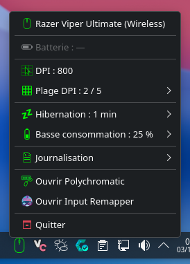

### Low-power mode

Viper Ultimate Tray allows you to configure the battery level at which the mouse enters low-power mode.

The available thresholds range from 5% to 25%. The values are provided in 5% increments rather than exposing every possible percentage.

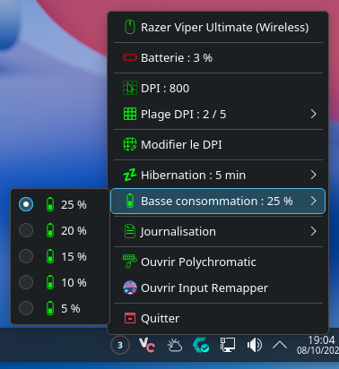

When the selected threshold is reached, the mouse enters low-power mode. In this mode, the tracking speed and sensor acceleration are reduced to conserve battery life.

### Notifications

Viper Ultimate Tray displays desktop notifications for important battery and application events.

#### Low-battery notifications

The application sends a notification when the battery level reaches each low-battery threshold: 30%, 15%, and 5%.

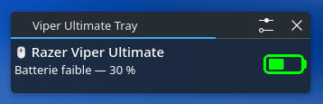 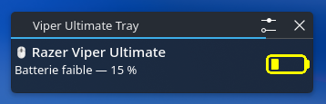 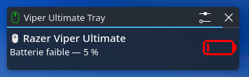

Each threshold is notified only once while the battery level remains at or below that threshold. The notification becomes available again when the battery level rises above the threshold.

#### Charge complete notification

When the battery reaches 100% while charging, Viper Ultimate Tray displays a charge-complete notification.

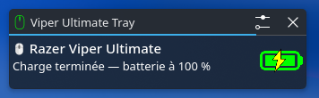

The notification is displayed only once during a charging cycle and becomes available again when charging stops.

#### Connection change notification

Viper Ultimate Tray notifies the user when the mouse connection mode changes between wired and wireless operation.

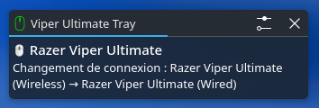

#### Battery Logger start failure notification

If a battery logging session cannot be started, Viper Ultimate Tray displays a notification explaining the reason when it is available.

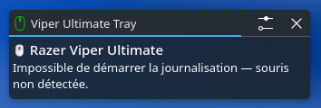

### Battery logging

Viper Ultimate Tray provides two complementary tools for recording and analyzing battery data: the **Battery Logger** records battery changes over time, while **Charge Data** provides access to recorded charging samples and the charging models built from them.

The recorded charging data is used to build charging models that allow Viper Ultimate Tray to estimate the remaining time until the battery is fully charged. When the mouse is charging, this estimate is displayed directly in the tray menu.

The logger and the charge data can be opened from **Journalisation** in the tray menu.

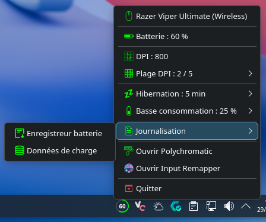

#### Battery Logger

The **Battery Logger** records battery data while the mouse is being used or charged.

When the Battery Logger window is opened without an active logging session, the window displays the available controls and an empty log.

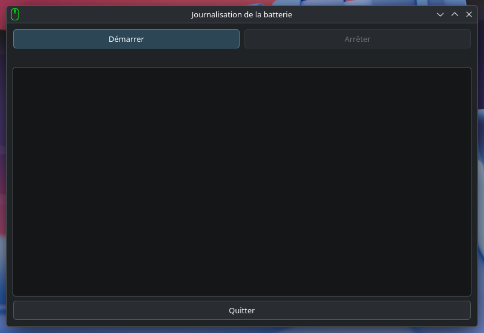

Clicking **Démarrer** starts a logging session. The window displays the detected connection mode and the logging interval. The logging duration is updated while the session is active.

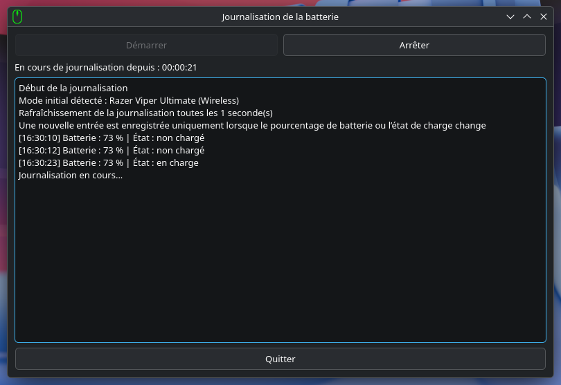

The logger checks the battery state every second by default, but records a new entry only when the battery percentage or charging state changes.

While logging is active, the **Journalisation** menu displays the elapsed time of the current logging session.

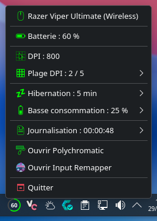

If the mouse switches between wired and wireless operation while logging, the current session is ended and processed, and a new session is started for the new connection mode.

Clicking **Arrêter** stops the logging session. The final duration remains displayed in the window after the logger has stopped.

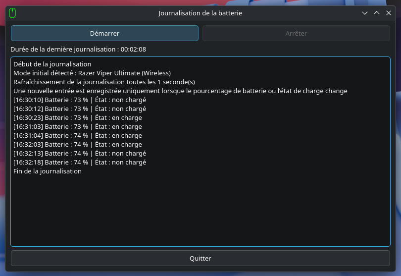

#### Charge Data

The **Charge Data** window provides access to the charging samples recorded by the Battery Logger and to the charging models calculated from those samples.

##### Samples

The **Samples** tab lists the recorded charging samples separately for wired and wireless charging.

When no sample is selected, the detail area remains empty.

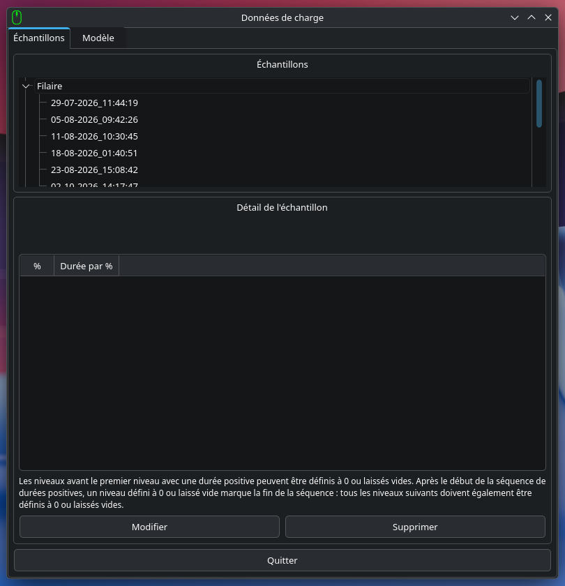

Selecting a sample displays its charging mode, creation date, and the recorded duration for each battery level.

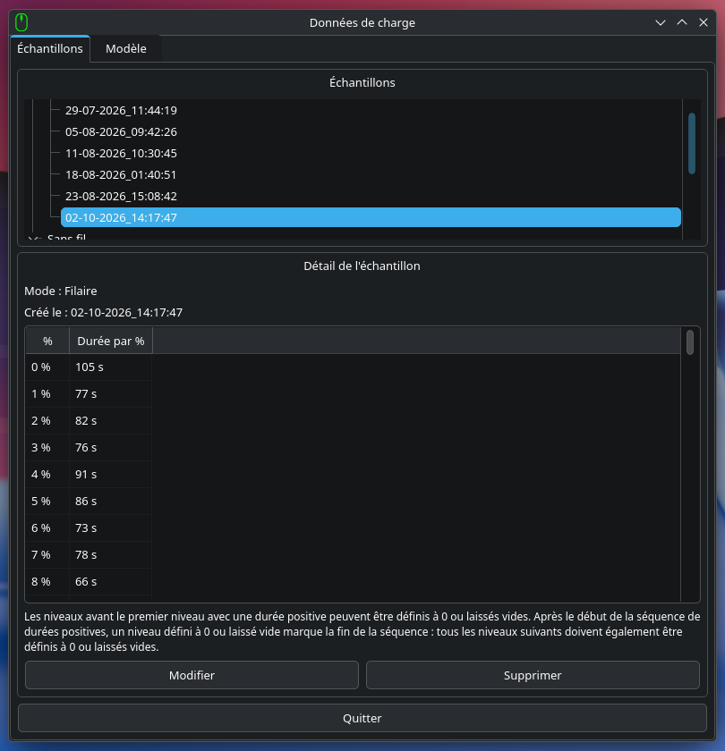

A selected sample can be modified with **Modifier**. During editing, the recorded durations can be changed or removed. Levels before the first recorded duration can be left empty or set to zero. Once the sequence of recorded durations has started, leaving a level empty or setting it to zero ends the sequence, and all following levels must also be empty or set to zero.

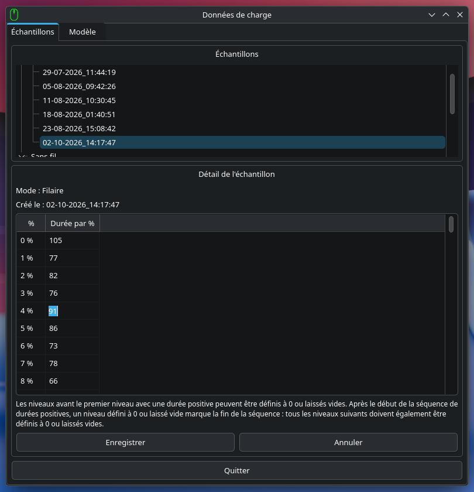

If the entered values are invalid, the changes are rejected and a warning is displayed.

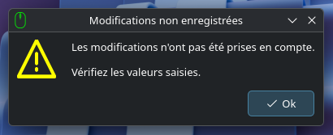

When the entered values are valid, clicking **Enregistrer** saves the modifications and displays a confirmation message.

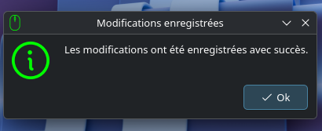

A selected sample can also be deleted with **Supprimer**. The application asks for confirmation before permanently deleting the sample.

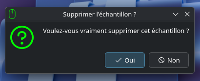

After the deletion has been completed, a confirmation message is displayed.

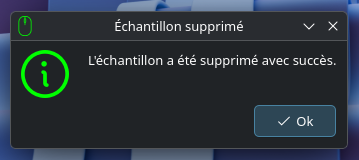

##### Model

The **Model** tab displays the charging models calculated from the recorded samples.

Separate models are maintained for wired and wireless charging. For each battery level, the table displays the average duration for that level and the cumulative duration required to reach 100%, together with the differences between wired and wireless charging.

The model is displayed in read-only mode.

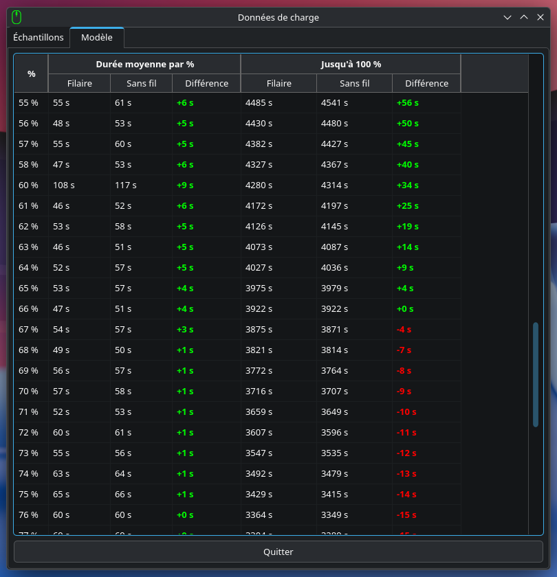

### Hotplug support

Viper Ultimate Tray continuously monitors the mouse connection and automatically detects disconnection and reconnection events.

The mouse state is polled every two seconds by default. If the mouse cannot be detected or its state cannot be retrieved, the application switches to a disconnected state. When the mouse becomes available again, its complete state is retrieved and the application resumes normal monitoring.

A temporary disconnection does not terminate an active Battery Logger session. The logger continues waiting for the mouse to become available again and resumes recording when it reconnects.

If the connection mode changes between wired and wireless operation, the current logging session is closed and processed before a new session is started for the new mode. This keeps wired and wireless charging data in separate logging sessions and allows each session to be analyzed independently.

The application also updates the tray status and notification state when the connection changes.

### Mouse Poller

The **Mouse Poller** is responsible for continuously retrieving the current mouse state without blocking the graphical interface.

The poller runs in a dedicated Python thread and retrieves the complete `MouseState` at a fixed interval of two seconds by default. The state includes the connection status, battery level, charging state and source, DPI configuration, hibernation timeout, and low-power threshold.

Each polling cycle produces a `MouseState` and emits it through a Qt signal. The application processes the state on the GUI side, where it updates the tray indicator, menu, notifications, and other components that depend on the current mouse state.

Connection failures are represented by a disconnected `MouseState` rather than being propagated to the graphical interface as polling exceptions. This allows the same polling mechanism to handle normal operation, temporary disconnection, and reconnection.

### Multi-threading

Viper Ultimate Tray keeps long-running and potentially blocking hardware operations outside the graphical interface thread.

The **Mouse Poller** runs in a dedicated thread and continuously retrieves the current mouse state. The **Battery Logger** also runs in its own thread while a logging session is active, allowing battery monitoring and device detection to continue without blocking the GUI.

The Battery Logger can trigger charge-data analysis when a logging session ends, including when a connection-mode change closes the current session. Charge analysis runs synchronously in the thread that invokes it rather than owning a separate worker thread.

Results produced by background operations are not sent directly to GUI handlers. The application uses private Qt signals to marshal worker-thread callbacks back to the GUI thread before updating windows, menus, notifications, and other user-interface components.

This separation keeps the graphical interface responsive while allowing hardware polling, battery logging, and background log processing to run independently where appropriate.

## Architecture

Viper Ultimate Tray is organized around a central `Application` object that coordinates mouse monitoring, device control, battery logging, charge-data analysis, notifications, and the KDE Plasma interface.

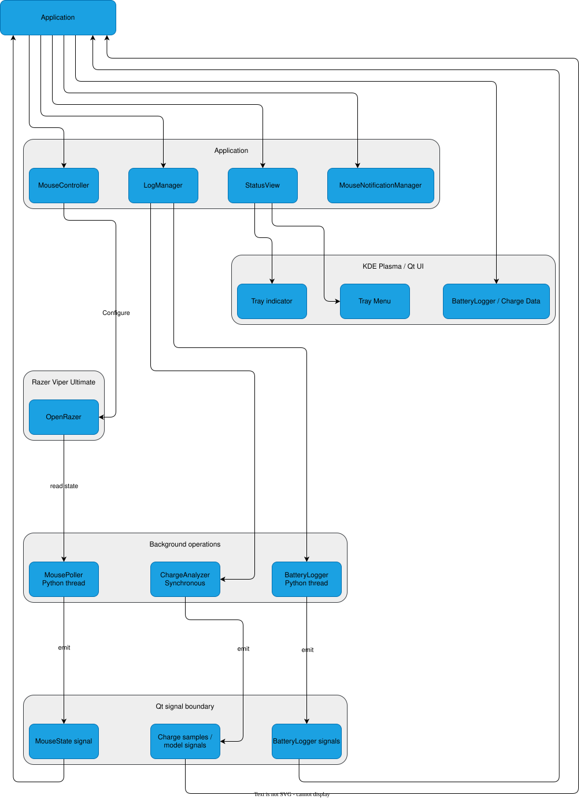

`MousePoller` continuously retrieves the complete mouse state through OpenRazer and provides it to the application. `MouseController` handles changes to the mouse configuration, while `StatusView` updates the tray indicator and menu from the current state.

`LogManager` coordinates battery logging and charge-data processing. `BatteryLogger` records battery activity in a dedicated thread, while `ChargeAnalyzer` processes completed charging sessions synchronously and maintains the recorded samples and charging models. The archiver and deleter handle the battery log files after processing.

The graphical interface is kept separate from long-running hardware and logging operations. Background components communicate their results through Qt signals so that GUI updates are handled safely by the application thread.

### Project structure

The repository separates the application source code, tests, documentation, installation scripts, and project configuration.


## Requirements

### Required

- Arch Linux or an Arch-based distribution;
- KDE Plasma 6 or newer;
- OpenRazer for communication with the mouse;
- A non-root user account;
- `pacman`;
- `paru`;
- `sudo`;
- `vercmp`.

### Dependencies

The installer automatically installs missing dependencies and updates dependencies that do not meet the required minimum versions.

The following packages are managed automatically:

- `python` >= 3.11;
- `pyside6` >= 6.6;
- `qt6-svg` >= 6.6;
- `kstatusnotifieritem` >= 6.0;
- `python-gobject` >= 3.44;
- `libnotify` >= 0.8.0;
- `python-openrazer` >= 3.12.2;
- `openrazer-daemon` >= 3.12.2;
- `noto-fonts`;
- `polychromatic`;
- one of `input-remapper`, `input-remapper-git`, or `input-remapper-bin`.

If no Input Remapper package is already installed, the installer installs `input-remapper-git`.

If `openrazer-daemon` is installed or updated, the installer automatically refreshes the OpenRazer udev rules and restarts the user daemon. A system reboot is not required.

## Installation

Clone the repository and run the installer from the project directory:

```bash
git clone https://github.com/IlanRossigneul/viper-ultimate-tray.git
cd viper-ultimate-tray
./install.sh
```

The installer checks the system requirements, installs missing dependencies, updates dependencies that do not meet the required minimum versions, and installs the application.

During installation, you can choose whether Viper Ultimate Tray should start automatically with your session.

The application is installed under `~/.local/share/viper-ultimate-tray`.

The installer also adds the following commands to `~/.local/bin`:

- `viper-ultimate-tray`: launches the application;
- `viper-ultimate-tray-uninstall`: removes the application.

Viper Ultimate Tray is also available from the KDE application launcher under the **Utilities** category.

The installer does not require a logout or reboot after a fresh installation.

### Reinstallation

When reinstalling Viper Ultimate Tray, the existing `archive` directory and its contents, as well as battery charge samples and model files, are preserved.

Other application files are replaced by the new installation.

The installer does not require a logout or reboot after a reinstallation.

## Uninstallation

If Viper Ultimate Tray is installed, the recommended way to uninstall it is:

```bash
viper-ultimate-tray-uninstall
```

If you still have the cloned repository, you can also run the uninstaller directly from the project directory:

```bash
./uninstall.sh
```

The uninstaller:

- stops Viper Ultimate Tray;
- removes the application runtime;
- removes the application and uninstaller wrappers;
- removes the KDE application launcher entry;
- removes session autostart.

The uninstaller does not remove the dependencies installed for Viper Ultimate Tray automatically.

The application runtime and its stored battery data are removed during uninstallation.

At the end of the uninstallation, the uninstaller displays the optional `pacman` and `paru` commands that can be used to remove these dependencies manually.

## Development and testing

The repository includes an automated test suite and continuous integration checks.

### Local checks

Run the test suite with:

```bash
pytest
```

Check the code with:

```bash
ruff check .
ruff format --check .
vulture . vulture_whitelist.txt
```

The Vulture whitelist contains the symbols that are intentionally considered used by the project but cannot be detected by Vulture's static analysis.

### Continuous integration

The project uses **GitHub Actions** to automatically validate changes pushed to the repository.

The CI workflow runs the same code quality and test checks used during local development:

- Ruff linting;
- Ruff formatting verification;
- Vulture analysis with the project whitelist;
- the complete pytest test suite.

The checks run in an Arch Linux environment to match the target distribution as closely as possible.

A change is considered validated when all CI checks complete successfully.

## Third-party assets

The following menu icons are provided by [Polychromatic](https://github.com/polychromatic/polychromatic):

- `src/icons/menu/dpi.svg`;
- `src/icons/menu/fast.svg`;
- `src/icons/menu/hibernation.svg`;
- `src/icons/menu/openrazer.svg`;
- `src/icons/menu/polychromatic.svg`;
- `src/icons/menu/slow.svg`;
- `src/icons/menu/stages-dpi.svg`.

The `src/icons/menu/input-remapper.svg` icon is provided by [Input Remapper](https://github.com/sezanzeb/input-remapper).

## License

No license is currently provided with this project.
