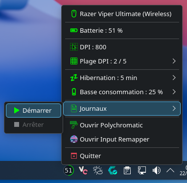
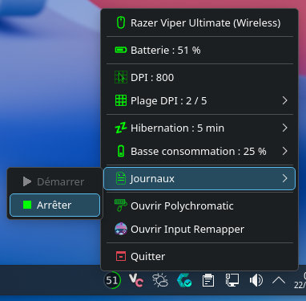

<!-- markdownlint-disable MD033 -->
#  Viper Ultimate Tray <!-- omit in toc -->
<!-- markdownlint-enable MD033 -->

**Viper Ultimate Tray** is a Linux system tray application for managing the **Razer Viper Ultimate** wireless mouse.


It provides a native KDE Plasma interface for monitoring the mouse and controlling its main settings, including battery status, DPI, power management, and charging-related options.

The application is designed for **Arch Linux and Arch-based distributions**, with **KDE Plasma 6 or newer** and **OpenRazer** as its hardware interface.

It supports both **Wayland and X11** sessions and is designed to handle wireless and wired operation, including mouse disconnection and reconnection.

## Table of contents <!-- omit in toc -->

- [Features](#features)
- [Requirements](#requirements)
  - [Required](#required)
  - [Dependencies](#dependencies)
- [Installation](#installation)
  - [Reinstallation](#reinstallation)
- [Uninstallation](#uninstallation)
- [Tray / Menu](#tray--menu)
  - [Tray](#tray)
  - [Menu](#menu)
- [Battery monitoring and charge estimation](#battery-monitoring-and-charge-estimation)
  - [Not charging](#not-charging)
  - [Charging](#charging)
- [DPI Control](#dpi-control)
- [Hibernation](#hibernation)
- [Low-power threshold](#low-power-threshold)
- [Battery logging](#battery-logging)
- [Battery notifications](#battery-notifications)
  - [Low-battery notifications](#low-battery-notifications)
  - [Charge complete notification](#charge-complete-notification)
- [Hotplug support](#hotplug-support)
- [Mouse Poller](#mouse-poller)
- [Architecture](#architecture)
  - [Project structure](#project-structure)
- [Development and testing](#development-and-testing)
- [Third-party assets](#third-party-assets)
- [License](#license)

## Features

- **Battery monitoring and charge estimation**: Monitor the mouse battery level and charging state directly from the tray menu, with an estimated remaining charging time while charging;
- **Wired and wireless operation**: Detect whether the mouse is connected wirelessly or through USB, including disconnection and reconnection;
- **DPI control**: Select the mouse DPI directly from the default DPI stages configured on the mouse;
- **Hibernation**: Configure the mouse hibernation timeout to control its power consumption while idle;
- **Low-power threshold**: Configure the battery level at which the mouse enters low-power mode;
- **Battery logging**: Record battery data and build separate charging models for wired and wireless operation from real charging sessions;
- **Battery notifications**: Receive notifications when the battery reaches configured low-battery thresholds or when charging is complete;
- **Hotplug support**: Automatically handle mouse disconnection and reconnection without restarting the application;
- **External tools**: Launch compatible tools such as Polychromatic and Input Remapper directly from the tray menu.

## Requirements

### Required

- Arch Linux or an Arch-based distribution;
- KDE Plasma 6 or newer;
- OpenRazer for communication with the mouse;
- A non-root user account;
- `pacman`;
- `sudo`;
- `vercmp`.

### Dependencies

The installer automatically installs missing dependencies and installs newer package versions when the installed version does not meet the required minimum.

The following packages are managed automatically:

- `python` >= 3.11;
- `pyside6` >= 6.6;
- `kstatusnotifieritem` >= 6.0;
- `python-gobject` >= 3.44;
- `libnotify` >= 0.8.0;
- `python-openrazer` >= 3.12.2;
- `openrazer-daemon` >= 3.12.2.

If `openrazer-daemon` is installed or updated, the installer automatically refreshes the OpenRazer udev rules and restarts the user daemon. A system reboot is not required.

## Installation

Clone the repository and run the installer from the project directory:

```bash
git clone https://github.com/IlanRossigneul/viper-ultimate-tray.git
cd viper-ultimate-tray
./install.sh
```

The installer checks the system requirements, installs missing dependencies, updates dependencies that do not meet the required minimum versions, and installs the application.

During installation, you can choose whether Viper Ultimate Tray should start automatically with your session.

The application is installed under `~/.local/share/viper-ultimate-tray`.

The installer also adds the following commands to `~/.local/bin`:

- `viper-ultimate-tray`: launches the application;
- `viper-ultimate-tray-uninstall`: removes the application.

Viper Ultimate Tray is also available from the KDE application launcher under the **Utilities** category.

The installer does not require a logout or reboot after a fresh installation.

### Reinstallation

When reinstalling Viper Ultimate Tray, the existing `archive` directory and its contents, as well as battery charge samples and model files, are preserved.

Other application files are replaced by the new installation.

The installer does not require a logout or reboot after a reinstallation.

## Uninstallation

If Viper Ultimate Tray is installed, the recommended way to uninstall it is:

```bash
viper-ultimate-tray-uninstall
```

If you still have the cloned repository, you can also run the uninstaller directly from the project directory:

```bash
./uninstall.sh
```

The uninstaller:

- stops Viper Ultimate Tray;
- removes the application runtime;
- removes the application and uninstaller wrappers;
- removes the KDE application launcher entry;
- removes session autostart.

The uninstaller does not remove the dependencies installed for Viper Ultimate Tray automatically.

At the end of the uninstallation, the uninstaller displays the optional `pacman` commands that can be used to remove these dependencies manually.

## Tray / Menu

### Tray

The tray icon provides an at-a-glance overview of the mouse status.

Its appearance reflects the current battery level and whether the mouse is charging or discharging. The tray icon also indicates when the mouse is disconnected or in hibernation, using the same icon for both states.

<!-- markdownlint-disable MD033 -->
<div style="display: flex; align-items: center; gap: 30px;">
  
  <span>>= 50% &amp; <= 100%</span>
</div>

<div style="display: flex; align-items: center; gap: 30px;">
  
  <span>>= 20% &amp; < 50%</span>
</div>

<div style="display: flex; align-items: center; gap: 30px;">
  
  <span>>= 0% &amp; < 20%</span>
</div>

<div style="display: flex; align-items: center; gap: 30px;">
  
  <span>>= 0% &amp; <= 100%</span>
</div>

<div style="display: flex; align-items: center; gap: 30px;">
  
  <span>Mouse disconnected or in hibernation</span>
</div>
<!-- markdownlint-enable MD033 -->

### Menu

The tray menu provides access to the mouse status and the application's main controls.

- **Connection**: Indicates whether the mouse is connected through USB or wirelessly;
- **Battery**: Displays the current battery level and charging state;
- **DPI**: Displays the currently selected DPI and provides access to the available DPI stages;
- **Hibernation**: Configures the mouse hibernation timeout;
- **Low-power threshold**: Configures the battery level at which the mouse enters low-power mode;
- **Battery log**: Starts and stops battery logging;
- **Polychromatic**: Provides a direct link to launch Polychromatic when it is installed;
- **Input Remapper**: Provides a direct link to launch Input Remapper when it is installed.

## Battery monitoring and charge estimation

Viper Ultimate Tray continuously monitors the Razer Viper Ultimate battery status and automatically refreshes the tray menu every 2 seconds. The displayed information is updated without requiring the menu to be reopened.

The battery icon in the tray menu changes according to the current battery level, using several charge-level stages. It also reflects the current battery state: when the mouse is charging, a yellow lightning bolt is displayed on the battery icon.

### Not charging

When the mouse is not charging, the tray menu displays the current battery level and wireless connection status.


The battery icon reflects the current charge level.

<!-- markdownlint-disable MD033 -->
<div style="display: flex; align-items: center; gap: 30px;">
  
  <span>> 75% &amp; <= 100%</span>
</div>

<div style="display: flex; align-items: center; gap: 30px;">
  
  <span>> 50% &amp; <= 75%</span>
</div>

<div style="display: flex; align-items: center; gap: 30px;">
  
  <span>> 25% &amp; <= 50%</span>
</div>

<div style="display: flex; align-items: center; gap: 30px;">
  
  <span>> 10% &amp; <= 25%</span>
</div>

<div style="display: flex; align-items: center; gap: 30px;">
  
  <span>>= 0% &amp; <= 10%</span>
</div>
<!-- markdownlint-enable MD033 -->

### Charging

When the mouse is charging, the tray menu indicates that charging is in progress and displays an estimated remaining charging time based on the available charging data.

The application maintains separate models for wired and wireless charging, allowing the estimated charging time to reflect the charging method currently in use.

 

The battery icon reflects the current charge level and displays a yellow lightning bolt to indicate that the battery is charging.

<!-- markdownlint-disable MD033 -->
<div style="display: flex; align-items: center; gap: 30px;">
  
  <span>> 75% &amp; <= 100%</span>
</div>

<div style="display: flex; align-items: center; gap: 30px;">
  
  <span>> 50% &amp; <= 75%</span>
</div>

<div style="display: flex; align-items: center; gap: 30px;">
  
  <span>> 25% &amp; <= 50%</span>
</div>

<div style="display: flex; align-items: center; gap: 30px;">
  
  <span>> 10% &amp; <= 25%</span>
</div>

<div style="display: flex; align-items: center; gap: 30px;">
  
  <span>>= 0% &amp; <= 10%</span>
</div>
<!-- markdownlint-enable MD033 -->

## DPI Control

Viper Ultimate Tray allows you to change the mouse DPI directly from the tray menu.

The available DPI values are the DPI stages currently configured on the mouse. Selecting a value immediately switches the mouse to that DPI stage.


The selected DPI stage is synchronized with the mouse: changing the DPI from the tray updates the corresponding DPI indicator LED on the mouse, while changing the DPI directly from the mouse updates the selected stage in the **DPI Stages** submenu.

## Hibernation

Viper Ultimate Tray allows you to configure the mouse hibernation timeout directly from the tray menu.

The available timeout values can be selected from the **Hibernation** submenu.


When the mouse enters hibernation, its battery level is no longer available. The tray menu therefore displays `Batterie : —` while the mouse is asleep.


## Low-power threshold

Viper Ultimate Tray allows you to configure the battery level at which the mouse enters low-power mode.

The available thresholds range from 5% to 25%. The values are provided in 5% increments rather than exposing every possible percentage.


When the selected threshold is reached, the mouse enters low-power mode. In this mode, the tracking speed and sensor acceleration are reduced to conserve battery life.

## Battery logging

Viper Ultimate Tray allows you to start and stop battery logging directly from the tray menu.

When logging is stopped, **Start** is available and **Stop** is disabled.



When logging is active, **Stop** is available and **Start** is disabled.



Battery logs are used to build the charge estimation models for wired and wireless charging.

## Battery notifications

Viper Ultimate Tray displays desktop notifications when the mouse reaches specific battery levels while discharging, and when charging is complete.

### Low-battery notifications

Three low-battery notifications are available:

- **30%**: displayed when the battery falls to 30% or below;
- **15%**: displayed when the battery falls to 15% or below;
- **5%**: displayed when the battery falls to 5% or below.

  

Each low-battery notification is displayed once when its threshold is crossed. It becomes available again after the battery level rises above the corresponding threshold.

### Charge complete notification

When the mouse reaches 100% while charging, Viper Ultimate Tray displays a notification indicating that charging is complete.


The charge complete notification is displayed once per charging cycle and becomes available again when charging stops.

## Hotplug support

Viper Ultimate Tray automatically detects when the mouse is disconnected or reconnected.

When the mouse is disconnected, the tray icon changes to the disconnected state and the mouse information is no longer available.


Battery logging remains active if it was already running, allowing it to be stopped while the mouse is disconnected. If logging is not running, the **Start** action is disabled until the mouse is reconnected.

When the mouse becomes available again, Viper Ultimate Tray automatically detects the reconnection and resumes monitoring the mouse. The battery logging controls are restored according to the current logging state.

No application restart is required.

## Mouse Poller

The **Mouse Poller** is responsible for periodically checking the mouse connection state and notifying the application when that state changes.

It uses a Qt timer to poll the mouse every **2 seconds** by default.

For each poll, the current mouse state is retrieved through the OpenRazer interface:

- If the mouse is connected, the current `MouseState` is passed to the application;
- If the mouse reports that it is not connected, the application is notified of the disconnection;
- If retrieving the mouse state raises an exception, the mouse is also treated as disconnected.

The poller keeps track of the previous connection state so that connection and disconnection events are logged only when the state actually changes.

When a previously disconnected mouse becomes available again, the poller notifies the application with the new `MouseState`, allowing the application to restore its normal state and controls.

The poller runs continuously while the application is running and does not require the application to be restarted after a mouse disconnection.

## Architecture

Viper Ultimate Tray is organized into separate modules for application management, battery monitoring and charge estimation, battery logging, Razer device control, notifications, and the KDE Plasma user interface.

The application entry point creates the main application object, which coordinates the tray interface, mouse state monitoring, battery logging, notifications, and mouse controls.

The Razer-specific modules provide the interface with OpenRazer and handle mouse state retrieval, device control, and connection monitoring.

Battery logging and charge estimation are kept separate from the user interface. This allows battery data to be collected, analyzed, archived, and used to build charging models independently from the tray controls.

### Project structure

The repository is organized into the application source code and tests.


## Development and testing

The repository includes tests for the project.

Run the test suite with:

```bash
pytest
```

Check the code with:

```bash
ruff check .
ruff format --check .
vulture .
```

The reported `vulture` warnings have been reviewed and are known false positives.

## Third-party assets

The tray battery icons in `src/icons/tray/` are based on icons from [RazerBatteryTray](https://github.com/HoroTW/RazerBatteryTray) by HoroTW.

## License

No license is currently provided with this project.
